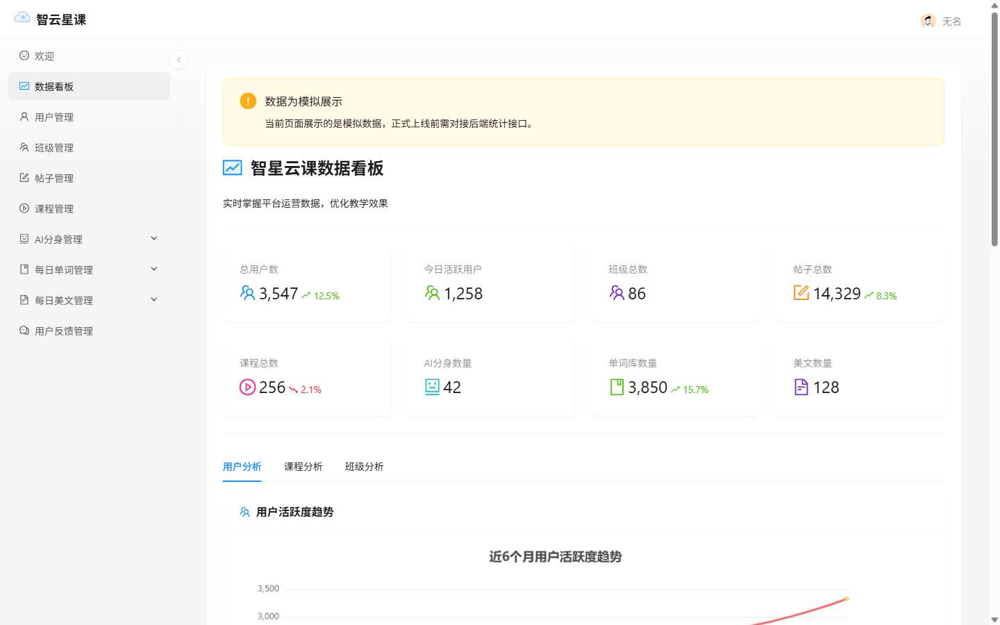
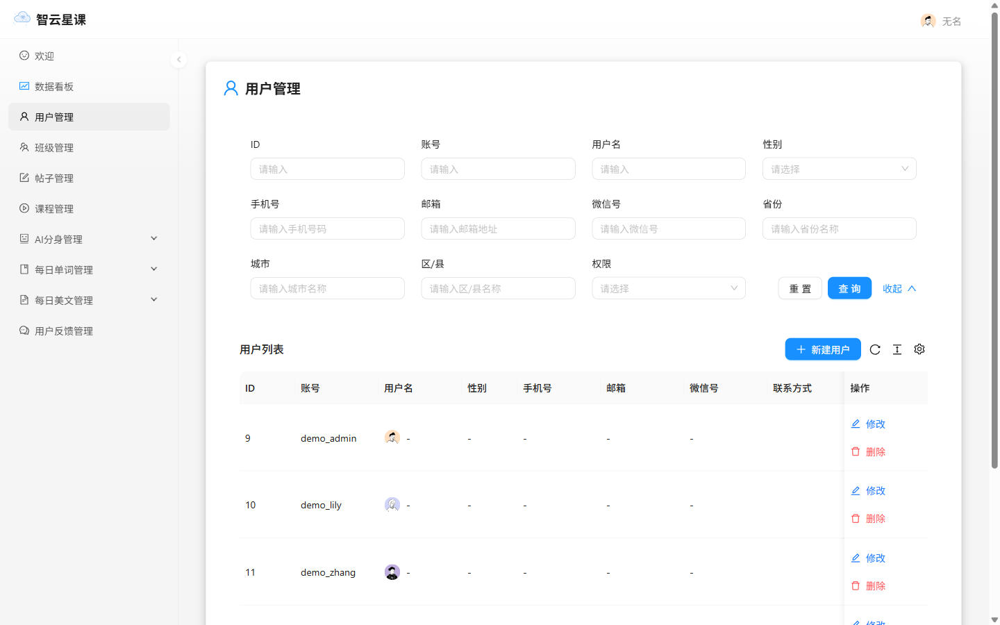

# 智云星课（SmartClass）

> AI 驱动的在线学习平台：Spring Boot 双模式后端 + Vue3 移动端 + React 管理端，集成 Dify 流式问答、RAG 课程检索与 AI 习题生成。

 

## 功能特性

- **AI 学习伙伴**：基于 Dify 的智能体流式问答、学习路径规划、AI 习题生成
- **课程学习**：课程/章节/资料、学习进度跟踪、收藏与评价
- **每日打卡**：每日单词、每日美文、生词本
- **社区**：帖子流（Markdown + 公式渲染）、点赞收藏、私聊（Netty WebSocket）
- **VIP 支付**：订单/回调验签/会员权益，支持模拟支付联调开关
- **管理端**：用户/课程/内容/反馈管理与数据看板

## 界面预览

移动端（Vue3 + Vant）：

<p>
  
  
  
  
  
</p>

管理端（React18 + Ant Design）：

<p>
  
  
  
</p>

## 快速开始（单体模式）

环境要求：JDK 17、Maven 3.8+、Node ≥18、MySQL 8、Redis 7、Elasticsearch 8.15（可选，仅 AI 检索需要）。

```bash
# 1. 基础设施（Docker，密码可自定，后续保持一致）
docker run -d --name sc-mysql -e MYSQL_ROOT_PASSWORD=<mysql-password> -p 3306:3306 mysql:8.0
docker run -d --name sc-redis -p 6379:6379 redis:7.2 --requirepass <redis-password>
docker exec sc-mysql mysql -uroot -p<mysql-password> -e "CREATE DATABASE smart_class DEFAULT CHARACTER SET utf8mb4"

# 2. 构建并启动（Flyway 自动建表；dev 模式监听 12345，接口前缀 /api）
cd smartclass-backend
mvn package -DskipTests
MYSQL_PASSWORD=<mysql-password> REDIS_PASSWORD=<redis-password> \
JWT_SECRET=$(openssl rand -hex 32) SPRING_PROFILES_ACTIVE=dev \
java -jar target/smartclass-backend-0.0.1-SNAPSHOT.jar

# 冒烟：curl http://localhost:12345/api/actuator/health → {"status":"UP"}
# （若 Elasticsearch 未运行，health 整体为 DOWN 属预期——ES 仅 AI 检索需要；核心服务看启动日志「Started SmartClassApplication」）
```

> 命令在 Git Bash / macOS / Linux 可直接照抄（`openssl` 随 Git 自带）；接口文档：<http://localhost:12345/api/doc.html>

**前端**（两个独立应用，均已默认连接 `localhost:12345`）：

```bash
cd smartclass-frontend         && npm install && npm run dev   # 移动端（Vue3 + Vant）
cd smartclass-manage-frontend  && npm install && npm run dev   # 管理端（React18 + antd5 + UmiJS）
```

**管理员账号**：无预置账号，注册后提权再登录：

```bash
docker exec sc-mysql mysql -uroot -p<mysql-password> smart_class \
  -e "UPDATE user SET userRole='admin' WHERE userAccount='你的账号'"
```

## 环境变量（单体）

| 变量 | 必填 | 说明 |
|---|---|---|
| `MYSQL_PASSWORD` | 是 | MySQL 密码 |
| `REDIS_PASSWORD` | 是 | Redis 密码 |
| `JWT_SECRET` | 是 | ≥32 字节，启动时强制校验（`openssl rand -hex 32`） |
| `CORS_ALLOWED_ORIGINS` | prod 必填 | 逗号分隔前端源，如 `http://localhost:4173`；未配置拒绝启动 |
| `MYSQL_URL` / `MYSQL_USERNAME` | 否 | 默认 `localhost:3306/smart_class`；prod 默认用户 `smartclass_app` |
| `ES_URIS` / `ES_USERNAME` / `ES_PASSWORD` | 否 | 默认本机 9200 无认证 |
| `DIFY_API_KEY` / `DIFY_BASE_URL` | 否 | Dify 大模型服务；未配置时 AI 功能降级 |
| `CAPTCHA_ENABLE` | 否 | 图形验证码，默认 `true` |
| `PAY_MOCK_ENABLED` | 否 | 模拟支付开关，默认 `false`（关闭时支付接口拒绝下单） |
| `RAG_ENABLED` / `RAG_FULL_SYNC_ON_STARTUP` | 否 | ES 课程检索与启动全量同步，默认均 `false` |

## 微服务模式（可选）

`smartclass-backend-microservice` 提供 Dubbo3 + Nacos + Gateway 拆分版本（16 服务，网关 `8101`），与单体共享同一套数据库：

```bash
cd smartclass-backend-microservice
cp .env.example .env    # 填写 MYSQL_ROOT_PASSWORD / JWT_SECRET / INTERNAL_CALL_TOKEN
docker compose up -d
```

构建：`mvn package`（父 POM 已配置按模块生成可执行 jar）。

## 测试

```bash
cd smartclass-backend
TEST_MYSQL_URL=jdbc:mysql://localhost:3306/smart_class \
MYSQL_USERNAME=root MYSQL_PASSWORD=<mysql-password> \
REDIS_PASSWORD=<redis-password> mvn test
```

COS 对象存储用例未配置凭证时自动跳过。

## 已知限制

- Elasticsearch 中文检索依赖 [IK 分词插件](https://release.infinilabs.com/)（启用 RAG 前需安装并手动建索引）
- 微信支付为沙箱/模拟实现，生产接入需替换 `PaymentOrderServiceImpl` 渠道调用
- 前端生产域名在 `smartclass-frontend/.env.production` 与 `smartclass-manage-frontend/src/constants/index.ts` 中为占位符，部署前须替换

## 更多文档

[docs/](docs/)（模块设计、OpenAPI 客户端生成）· [项目优化评审报告.md](项目优化评审报告.md)（全量问题清单与修复实录，附录 A–K）

## 许可证

[AGPL-3.0](LICENSE)
