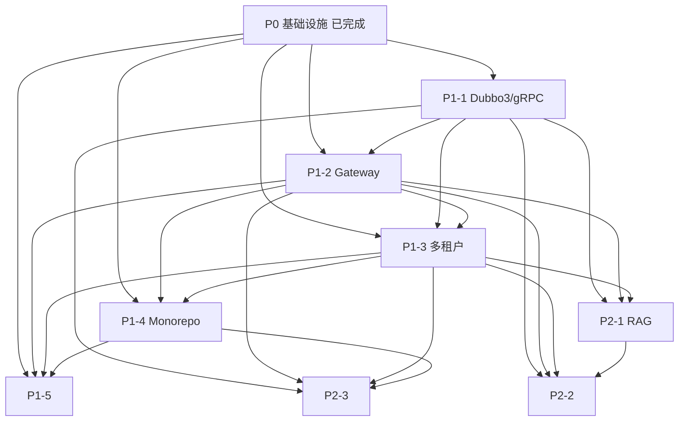

# 智云星课 P1/P2 技术调研与方案设计汇总

## 文档清单

| 编号 | 主题 | 文件 | 状态 |
|------|------|------|------|
| **P0-1** | Spring AI + Dify 集成 | 已实现 (代码) | ✅ 完成 |
| **P0-2** | 观测性 | 已实现 (代码) | ✅ 完成 |
| **P0-3** | CI/CD 流水线 | 已实现 (代码) | ✅ 完成 |
| **P0-4** | Flyway 迁移 | 已实现 (代码) | ✅ 完成 |
| **P1-1** | Dubbo3/gRPC 微服务通信 | `docs/P1-1-dubbo3-grpc-migration-design.md` | 📋 设计完成 |
| **P1-2** | Spring Cloud Gateway 增强 | `docs/P1-2-gateway-enhancement-design.md` | 📋 设计完成 |
| **P1-3** | 多租户架构 | `docs/P1-3-multi-tenant-design.md` | 📋 设计完成 |
| **P1-4** | 前端 Monorepo (pnpm + Vite + Turborepo) | `docs/P1-4-frontend-monorepo-design.md` | 📋 设计完成 |
| **P1-5** | OpenAPI Generator 契约优先 | `docs/P1-5-openapi-generator-design.md` | 📋 设计完成 |
| **P2-1** | RAG 混合检索 + Rerank | `docs/P2-1-rag-hybrid-rerank-design.md` | 📋 设计完成 |
| **P2-2** | AI 学习路径 + 知识图谱 | `docs/P2-2-ai-learning-path-knowledge-graph-design.md` | 📋 设计完成 |
| **P2-3** | 实时协作 (Yjs/CRDT) | `docs/P2-3-realtime-collaboration-design.md` | 📋 设计完成 |

---

## 依赖关系图

---

## 实施路线图建议

### 阶段 1: 通信与网关基础 (Month 1-2)
| 周次 | 任务 | 产出 |
|------|------|------|
| 1-2 | **P1-1 Phase 0**: Proto 仓库、CI、Dubbo 基建 | 微服务通信基建就绪 |
| 3-4 | **P1-1 Phase 1**: user + intelligence 服务试点 | 核心链路 Dubbo 化 |
| 5-6 | **P1-2 Phase 1-2**: 统一鉴权、限流、熔断、日志 | 网关生产可用 |
| 7-8 | **P1-1 Phase 2**: 批量迁移剩余服务 | 全链路 Dubbo，移除 Feign/Sentinel |

### 阶段 2: 多租户与前端现代化 (Month 2-3)
| 周次 | 任务 | 产出 |
|------|------|------|
| 1-2 | **P1-3 Phase 0-1**: TenantContext、Row-Level 隔离 | 共享库多租户就绪 |
| 3-4 | **P1-4 Phase 0-1**: Monorepo 基建、shared/styles/stores 迁移 | 前端基建就绪 |
| 5-6 | **P1-3 Phase 2**: Schema/DB 隔离、Flyway 多租户 | 大客户独立部署能力 |
| 7-8 | **P1-4 Phase 2-3**: UI 组件库、API 客户端、页面迁移 | Mobile/Admin 统一技术栈 |

### 阶段 3: 契约与智能化 (Month 3-4)
| 周次 | 任务 | 产出 |
|------|------|------|
| 1-2 | **P1-5**: 后端 OpenAPI 规范化、生成器流水线 | 契约优先落地 |
| 3-4 | **P2-1 Phase 1-2**: Milvus/ES/Rerank 基建、Hybrid Pipeline | RAG 检索质量跃升 |
| 5-6 | **P2-2 Phase 1-2**: Neo4j 图谱、画像引擎、种子数据 | 知识图谱雏形 |
| 7-8 | **P2-1 Phase 3-4**: 评估体系、A/B 测试 | RAG 生产验证 |

### 阶段 4: 协作与高级体验 (Month 4-5)
| 周次 | 任务 | 产出 |
|------|------|------|
| 1-2 | **P2-3 Phase 1-2**: Hocuspocus 部署、Monaco/ProseMirror 集成 | 实时协作 MVP |
| 3-4 | **P2-2 Phase 3-4**: 路径生成算法、图谱可视化前端 | AI 学习路径上线 |
| 5-6 | **P2-3 Phase 3-4**: 评论系统、离线、导出、P2P | 协作功能完善 |
| 7-8 | 全链路联调、性能调优、文档交付 | 版本发布 |

---

## 资源需求估算

| 角色 | 阶段 1 | 阶段 2 | 阶段 3 | 阶段 4 | 备注 |
|------|--------|--------|--------|--------|------|
| **后端架构/核心** | 2 | 2 | 1 | 1 | P1-1/P1-2/P1-3 主力 |
| **后端业务** | 1 | 1 | 2 | 1 | P2-1/P2-2 算法落地 |
| **前端核心** | 0 | 2 | 1 | 2 | P1-4/P1-5/P2-3 主力 |
| **前端业务** | 0 | 1 | 1 | 1 | 页面迁移/组件开发 |
| **DevOps** | 1 | 1 | 0.5 | 0.5 | CI/CD/基建/监控 |
| **QA/测试** | 0.5 | 1 | 1 | 1 | 自动化/性能/安全 |
| **总计** | **4.5** | **7** | **5.5** | **5.5** | 峰值 ~7 人并行 |

---

## 关键风险与缓解

| 风险 | 概率 | 影响 | 缓解策略 |
|------|------|------|----------|
| **Dubbo3 迁移周期超预期** | 高 | 高 | 严格 Strangler Fig、双写灰度、保留回滚通道、里程碑强验收 |
| **多租户数据隔离漏洞** | 中 | 极高 | 数据库层 RLS 强制、代码层上下文强制、定期渗透测试 |
| **前端 Monorepo 迁移阻塞业务** | 中 | 高 | 渐进式迁移、共享包优先、并行双仓库过渡期 |
| **RAG/Rerank GPU 资源不足** | 中 | 中 | 先 CPU 版 BGE-Reranker、后续申请 GPU、量化模型 |
| **知识图谱冷启动数据质量** | 高 | 中 | 半自动化 (LLM 抽取 + 专家审核)、种子数据优先覆盖核心课程 |
| **实时协作大文档性能** | 中 | 中 | 分片加载、视口裁剪、WebWorker、Canvas 渲染 |
| **团队学习曲线陡峭** | 高 | 中 | 结对编程、内部分享、最佳实践文档化、前 2 周强辅导 |

---

## 决策待确认事项

| 事项 | 选项 | 建议 | 需确认方 |
|------|------|------|----------|
| **Dubbo 协议** | Triple vs gRPC 原生 | **Triple** (兼容 gRPC、Nacos 原生、治理内置) | 架构组 |
| **网关方案** | SCG + Filter vs Dubbo Gateway | **SCG + Filter** (复用现有、渐进式) | 架构组 |
| **多租户隔离级别** | Row-Level 起步 vs 直接 Schema | **Row-Level 起步** (成本低、覆盖 90% 场景) | 产品/架构 |
| **前端 Monorepo 工具链** | Turborepo vs Nx | **Turborepo** (更轻量、Vite 集成好) | 前端组 |
| **OpenAPI 生成时机** | CI 定时 vs 后端 Release 触发 | **Release 触发 + 定时兜底** | 后端/前端 |
| **RAG 向量库** | Milvus vs pgvector | **Milvus** (企业级、过滤器、扩展性) | 架构/运维 |
| **图谱数据库** | Neo4j vs PostgreSQL + Apache AGE | **Neo4j** (图算法原生、生态成熟) | 架构 |
| **协作编辑器** | Monaco + ProseMirror 双栈 vs CodeMirror 6 统一 | **双栈** (各领域最佳体验) | 前端组 |
| **P2P 协作** | 需要 vs 不需要 | **Phase 1 不需要，Phase 2 评估** | 产品 |

---

## 文档维护

- 所有设计文档位于 `docs/` 目录
- 代码实现同步更新对应文档的 "实现状态" 章节
- 重大变更需评审更新设计文档，保持文档即代码
- 季度回顾：对比设计与实现差距，沉淀经验